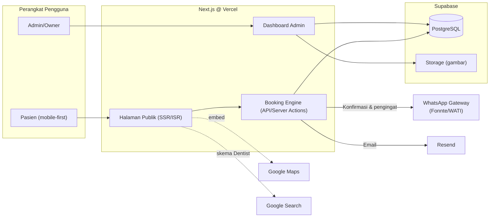

# Arsitektur Website Klinik — drg Dava Fathiyatuzzakiyah

Dokumen arsitektur & roadmap untuk website praktik dokter gigi. Target: website cepat, mudah dikelola staf non-teknis, dan benar-benar membawakan pasien (bukan sekadar brosur digital).

---

## 1. Tujuan & Sasaran

1. **Kredibilitas** — profil klinik & drg Dava yang terlihat profesional.
2. **Konversi** — jalur termudah untuk membuat janji temu (booking online + WhatsApp).
3. **SEO lokal** — muncul di pencarian "dokter gigi terdekat / dokter gigi [kota]".
4. **Operasional** — mengurangi beban telepon/manual: jadwal, konfirmasi, pengingat.
5. **Mudah dikelola** — konten (layanan, harga, promo, blog) bisa diedit lewat dashboard.

---

## 2. Ringkasan Stack (Rekomendasi)

Skenario klinik kecil–menengah, 1 dokter (siap dikembangkan multi-dokter), budget ramping.

| Lapisan | Pilihan | Alasan |
|---|---|---|
| Framework | **Next.js 15 (App Router) + TypeScript** | 1 repo untuk web publik + dashboard + API; SSR/ISR bagus untuk SEO |
| Styling | Tailwind CSS + shadcn/ui | Cepat dibangun, konsisten, aksesibel |
| Database | **PostgreSQL via Supabase** (free tier cukup di awal) | Managed, ada Storage untuk gambar, backup otomatis |
| ORM | Prisma | Skema jelas, migrasi aman |
| Auth (khusus admin) | Auth.js (credentials) *atau* Supabase Auth | Hanya 2–3 user admin, tidak perlu sistem rumit |
| Hosting | **Vercel** + CI/CD GitHub Actions | Deploy otomatis, CDN global, gratis di awal |
| Email | Resend (free 3.000/bln) | Konfirmasi & pengingat booking |
| WhatsApp | Fase 1: link `wa.me` manual → Fase 3: gateway (Fonnte/WATI) | Gateway resmi (WABA) mahal dan butuh verifikasi; WA sangat dominan di Indonesia |
| Analitik | GA4 / Plausible + Google Business Profile | Mengukur sumber pasien |
| Peta | Google Maps embed | Standar pencarian lokasi |

**Alternatif lebih ringan** (jika booking online belum dibutuhkan): Astro + halaman statis + tombol WhatsApp, host di Vercel/Cloudflare Pages. Upgrade ke Next.js saat fase booking dimulai.

---

## 3. Diagram Arsitektur



Seluruh penulisan ke database dilakukan melalui API/server actions — frontend publik **tidak pernah** menulis langsung ke database (rule Supabase RLS tetap diaktifkan sebagai lapisan kedua).

---

## 4. Halaman Publik

| Rute | Isi | Catatan |
|---|---|---|
| `/` | Hero + CTA Booking, layanan unggulan, keunggulan, testimoni terpilih, Lokasi + jam praktik, FAQ ringkas | Halaman terpenting; mobile-first |
| `/layanan` | Daftar semua layanan + harga mulai | Transparansi harga meningkat konversi |
| `/layanan/[slug]` | Detail 1 layanan: apa, prosedurnya, durasi, harga mulai, FAQ, CTA booking | Halaman SEO per layanan |
| `/tentang` | Profil drg Dava: foto, pendidikan, pengalaman, sertifikasi, filosofi praktik | Bangun kepercayaan |
| `/booking` | Form booking bertahap | Lihat §6 |
| `/blog`, `/blog/[slug]` | Artikel edukasi (MDX) | SEO organik jangka panjang |
| `/galeri` | Foto klinik, sebelum-sesudah (dengan izin pasien) | Kepercayaan |
| `/kontak` | Peta, nomor WA/telepon, jam praktik, sosmed | |
| `/promo` | Promosi berjalan | |
| `/kebijakan-privasi` | Kebijakan privasi & persetujuan data (UU PDP) | Wajib karena form menampung data pribadi |

JSON-LD `Dentist`/`LocalBusiness` (nama, alamat, geo, jam praktik, telepon) di semua halaman — ini yang menampilkan jam & alamat di hasil pencarian Google.

---

## 5. Model Data (Prisma)

```prisma
model Service {
  id          String   @id @default(cuid())
  name        String   // "Scaling & Polishing"
  slug        String   @unique
  description String
  priceFrom   Int?     // harga mulai (rupiah), null = "tanyakan"
  duration    Int      @default(30) // menit → dipakai slot booking
  icon        String?
  isActive    Boolean  @default(true)
  bookings    Booking[]
}

model Dentist {
  id       String    @id @default(cuid())
  name     String    // "drg Dava Fathiyatuzzakiyah"
  bio      String?
  photo    String?
  // multi-dokter-ready: bookings & Schedule terpaut dentistId
  bookings Booking[]
}

model OperatingHour {
  id        Int    @id @default(autoincrement())
  dentistId String?
  dayOfWeek Int    // 0=Min .. 6=Sab
  openTime  String // "09:00"
  closeTime String // "17:00"
  breakFrom String? // "12:00"
  breakTo   String? // "13:00"
}

model BlockedDate {
  id       Int    @id @default(autoincrement())
  date     DateTime
  reason   String?
}

model Booking {
  id        String   @id @default(cuid())
  code      String   @unique // DFA-260923-0001
  name      String
  phone     String
  email     String?
  serviceId String
  dentistId String?
  date      DateTime
  slotTime  String   // "10:30"
  status    String   @default("pending") // pending|confirmed|completed|cancelled|no_show
  notes     String?
  createdAt DateTime @default(now())
  @@unique([dentistId, date, slotTime]) // tidak ada slot kembar
}

model Testimonial {
  id         Int     @id @default(autoincrement())
  name       String
  rating     Int     // 1..5
  content    String
  photo      String?
  isApproved Boolean @default(false)
}

model Post {           // blog
  id          String   @id @default(cuid())
  title       String
  slug        String   @unique
  excerpt     String?
  coverImage  String?
  body        String   // MDX
  tags        String[]
  publishedAt DateTime?
}

model Promotion {
  id       Int    @id @default(autoincrement())
  title    String
  body     String
  image    String?
  isActive Boolean @default(true)
  endsAt   DateTime?
}

model Admin {
  id           String @id @default(cuid())
  email        String @unique
  passwordHash String
}
```

---

## 6. Alur Booking Online

```
Pasien memilih layanan
   └─ peraga tanggal & jam (dihitung: jam praktik − break − libur − slot terisi)
      └─ isi nama, WA, keluhan singkat
         └─ submit → status "pending" + kode booking unik
            ├─ Pasien: halaman konfirmasi + tangkapan kode, WA/email konfirmasi
            └─ Admin: notifikasi WA + entri muncul di kalender dashboard
               └─ Admin klik "Konfirmasi" / "Batalkan" → pasien menerima status terbaru
```

Aturan bisnis:
- Slot granularity 30 menit; telp/saldo double-booking dicegah oleh constraint unik.
- Kode format `DFA-YYMMDD-0001` — pasien bisa menyebut kode ini saat datang.
- Pasien dapat cek/batalkan lewat `/booking/[kode]` (tanpa login) atau via WA.
- Anti-spam: rate limit per nomor HP, honeypot field, reCAPTCHA/Turnstile opsional.
- penyimpanan data: consent checkbox di form + kebijakan privasi (UU PDP No.27/2022).

---

## 7. Dashboard Admin (`/admin`)

Fitur minimal yang benar-benar memotong kerja manual:

1. **Kalender booking** — ringkas per hari, klik slot → pasien/lengkap; aksi cepat: konfirmasi / tuntas / batalkan / no-show.
2. **Pengelolaan jadwal** — ubah jam praktik, tambah hari libur.
3. **CRUD layanan** — nama, harga mulai, durasi.
4. **Testimoni** — moderasi approve/reject.
5. **Blog & promo** — editor MDX sederhana + upload gambar.
6. **Ekspor CSV bookings** (untuk laporan/pembukuan).
7. Login tunggal admin; sesi httpOnly; 2FA opsional via TOTP belakangan.

---

## 8. Keamanan & Privasi

- Semua endpoint mutasi divalidasi (zod) + rate limit (Upstash).
- Database via service-role key hanya di server; RLS Supabase aktif untuk lapisan cadangan.
- Data pasien bersifat medis: encrypt at rest (bawaan Supabase), akses admin dibatasi, tidak ada data kesehatan rinci yang tersimpan — cukup keluhan singkat.
- Halaman kebijakan privasi + persetujuan di form (UU PDP).
- Backup otomatis harian Supabase; env secrets di Vercel.

---

## 9. Performa & SEO Checklist

- [ ] Mobile-first (sebagian besar trafik pasien datang dari HP via Instagram/Google).
- [ ] Core Web Vitals: LCP < 2,5 dtk (gambar AVIF/WebP via `next/image`, font `next/font`).
- [ ] ISR untuk halaman publik; statis untuk blog.
- [ ] JSON-LD: `Dentist`, `MedicalBusiness`, `FAQPage`, artikel `BlogPosting`.
- [ ] Klaim & sinkron **Google Business Profile** (sumber trafik lokal No.1).
- [ ] Sitemap dinamis + robots.txt; OG image per layanan/artikel.
- [ ] Verifikasi Search Console.

---

## 10. Struktur Folder Rencana

```
drg-dava/
├── prisma/schema.prisma
├── app/
│   ├── (public)/
│   │   ├── page.tsx              # Beranda
│   │   ├── layanan/
│   │   ├── tentang/page.tsx
│   │   ├── galeri/page.tsx
│   │   ├── promo/page.tsx
│   │   ├── kontak/page.tsx
│   │   ├── blog/[slug]/page.tsx
│   │   ├── booking/page.tsx
│   │   └── booking/[kode]/page.tsx
│   ├── admin/
│   │   ├── layout.tsx            # auth guard
│   │   ├── bookings/page.tsx
│   │   ├── layanan/page.tsx
│   │   └── testimoni/page.tsx
│   ├── api/
│   │   ├── bookings/route.ts     # POST create
│   │   └── availability/route.ts # GET slot tersedia
│   ├── layout.tsx
│   └── sitemap.ts
├── components/ (ui/, blocks/, booking/)
├── lib/ (db.ts, auth.ts, wa.ts, availability.ts, validators.ts)
├── content/blog/ (MDX)
└── public/ (logo, foto klinik)
```

---

## 11. Roadmap Bertahap

**Fase 1 — MVP Marketing (± 1–1,5 minggu)**
Beranda, layanan+harga, tentang, kontak+peta, galeri, tombol WA, JSON-LD, Go-Live.
→ klinik langsung punya kehadiran digital & bisa mulai terima janji via WhatsApp dari hari pertama.

**Fase 2 — Booking Online + Dashboard (± 2–3 minggu)**
Booking engine, availability, dashboard admin, ekspor CSV, kebijakan privasi.

**Fase 3 — Pertumbuhan (berkelanjutan)**
Blog SEO, testimoni+moderasi, promo page, otomasi WhatsApp (gateway), pengingat H-1, multi-bahasa opsional, integrasi Google Calendar untuk drg Dava.

---

## 12. Biaya Bulanan (perkiraan saat stabil)

| Item | Biaya |
|---|---|
| Domain (.com / .id) | ~Rp 100–300 rb / tahun |
| Vercel | Gratis (Pro $20/bln jika trafik naik) |
| Supabase | Gratis (Pro $25/bln saat backup/storage butuh lebih) |
| Resend | Gratis sampai 3.000 email/bln |
| WhatsApp gateway (Fase 3) | ± Rp 100–500 rb/bln sesuai volume |
